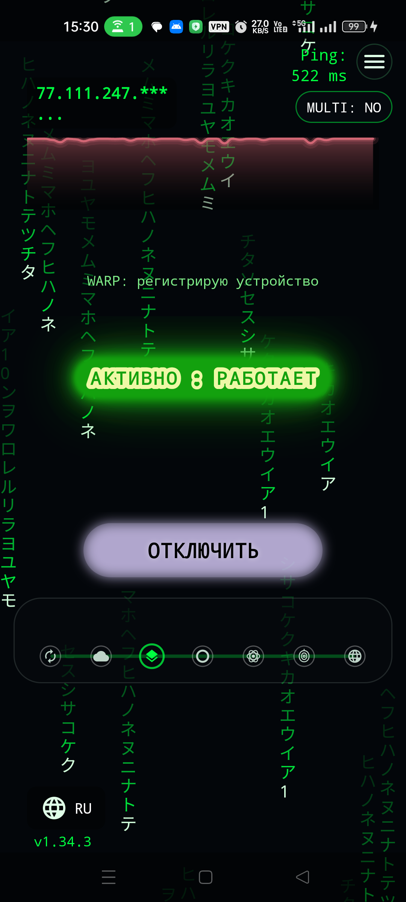
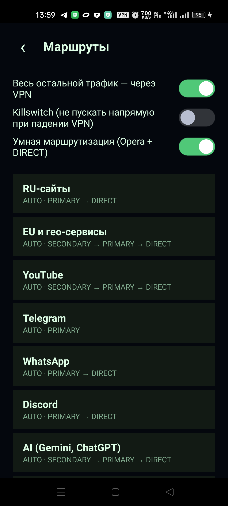

# OBNOVA VPN для Android

**OBNOVA** — личный форк [Nova Android](https://github.com/confeden/Nova-Android)
с переработанной маршрутизацией, обновлённым интерфейсом и рядом новых
возможностей. Версия **1.34.6 (versionCode 170)**, minSdk 24, targetSdk 34.

> Это **форк**, а не официальная сборка Nova. Оригинальный проект, его авторы и
> документация — в репозитории [confeden/Nova-Android](https://github.com/confeden/Nova-Android).

<p>
  
  
</p>

## Что нового по сравнению с upstream

- **MULTI-маршрутизация.** Одна VPN-сессия с несколькими слотами:
  `PRIMARY` (DESYNC или VLESS), `SECONDARY` (Opera HTTP CONNECT) и `DIRECT`.
  Переключение между ними выполняет собственный `nova-router` (Go, SOCKS5,
  TCP/UDP, статистика, горячая перезагрузка правил).
- **Умная маршрутизация по доменам и CIDR.** Правила проверяются по SNI из
  TLS ClientHello, поэтому IP-литералы Cronet (YouTube, Google) больше не
  проскакивают мимо правил. Для Telegram добавлены диапазоны ASN.
- **YouTube через Opera.** Медиа-хосты `googlevideo.com`/`ytimg.com` уходят в
  `SECONDARY`, служебные API Google — в `PRIMARY`, Play Services — отдельным
  правилом, чтобы не ловить `500` от Opera.
- **Telegram через MTProto-прокси.** IP прокси закреплён за рабочим слотом:
  правило `mtproto-proxy` ведёт его в `SECONDARY` (Opera) с откатом в
  `PRIMARY`/`cfproxy`.
- **Stage 2: изолированный AWG SOCKS.** Отдельный userspace-экземпляр
  AmneziaWG поднимает SOCKS5 на `127.0.0.1:1378` (слот `cfproxy`), не трогая
  глобальный `activeDevice`. Включается флагом `-PnovaCfProxySlot=true`.
- **Динамические списки.** `ListSync` забирает манифест, проверяет sha256 и
  раскладывает списки по зеркалам с повторными попытками.
- **Свои DNS и здоровье профилей.** TTL-кэш `DnsResponseCache`,
  `ProfileHealthRotation` (3 деградации, cooldown 15 минут, 2 смены в час,
  ручной выбор защищён).
- **Интерфейс.** Тема **Matrix** по умолчанию, `MatrixRainView` на главном
  экране, каналы в виде macOS-dock из SVG-иконок, системные insets, аккуратные
  настройки и верхняя плашка подтверждения выбора узла.

## Сборка

Требуются JDK 17, Android SDK (compileSdk 35) и Gradle wrapper.

```bash
# debug
./gradlew assembleGithubDebug

# release (нужен keystore.properties)
NOVA_ALLOW_UNPUBLISHABLE_BUILD=1 ./gradlew assembleGithubRelease
```

Go-ядро пересобирается только при его изменении:

```bash
tools/build_nova_core_aar.sh     # nova-core → AAR
(cd nova-xray && ./build.sh)     # VLESS-ядро
```

## Документация форка

- [`docs/architecture/ARCHITECTURE.md`](docs/architecture/ARCHITECTURE.md) — карта проекта.
- [`docs/fork/CHANGELOG.md`](docs/fork/CHANGELOG.md) — что и где изменено.
- [`docs/fork/VERIFICATION.md`](docs/fork/VERIFICATION.md) — фактические прогоны на устройстве.
- [`docs/fork/AGENT-HANDOFF.md`](docs/fork/AGENT-HANDOFF.md) — заметки для следующего разработчика.

## Ограничения

- Форк собран под личный ключ и не предназначен для публикации в магазинах
  приложений.
- Публичные VLESS-подписки проверяются реальным HTTPS-пробником; без живого
  узла `PRIMARY` остаётся на DESYNC.
- `cfproxy` (AWG-мост) зависит от доступности WARP-эндпоинта у оператора.

## Лицензия

Проект распространяется по [GPL-3.0](LICENSE), как и upstream
[Nova Android](https://github.com/confeden/Nova-Android). Сторонние компоненты
описаны в [THIRD-PARTY.md](THIRD-PARTY.md).
